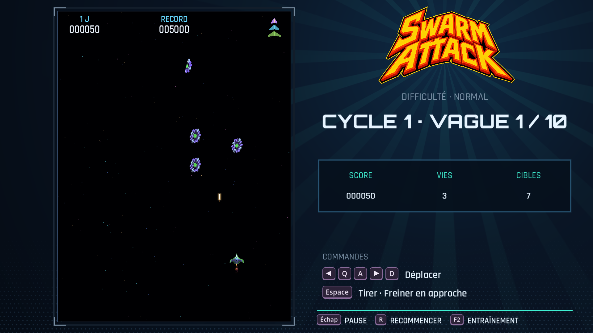
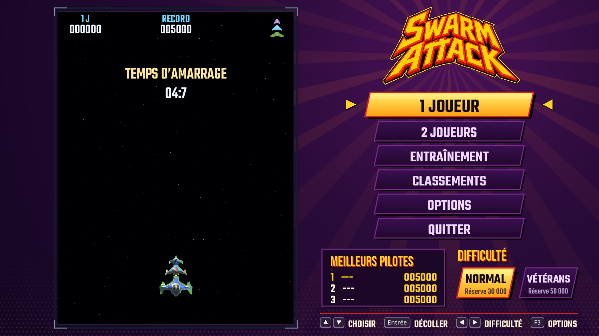
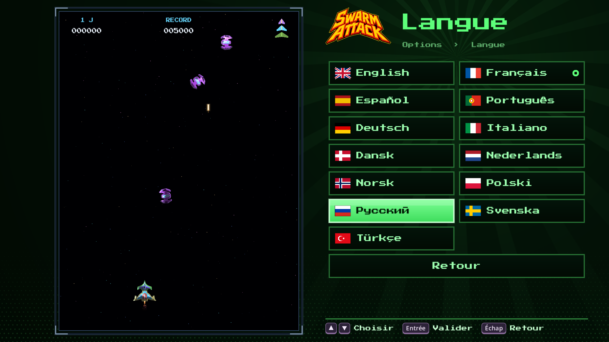

# SWARM ATTACK

SWARM ATTACK est un jeu de défense orbitale. Pilotez votre vaisseau à travers dix vagues et assemblez ses trois modules lors des manœuvres d’amarrage. Jouez en solo ou à deux en alternance sur le même PC.

**[Télécharger la 1.0.2 pour Windows x64](https://github.com/Kraran/SwarmAttack/releases/download/v1.0.2/SwarmAttack-1.0.2-Win64.zip)** · [Notes de version](https://github.com/Kraran/SwarmAttack/releases/tag/v1.0.2)

Décompressez l’archive et ouvrez `SwarmAttack.exe`. Espace lance une partie et sert à tirer. Déplacez-vous avec les flèches ou la manette. Échap ouvre le menu de pause et F5 coupe ou réactive le son.

| Amarrage d’un module | Thème Phosphore et treize langues |
| --- | --- |
|  |  |

La version 1.0.2 comprend :

- Des menus « Arcade » toujours placés à côté du terrain, trois thèmes (Orbital, Arcade, Phosphore), un fond animé plein écran, une introduction animée avec voix et musique, et un menu à droite ou à gauche au choix.
- Une navigation complète au clavier, à la manette et à la souris, en paysage comme en portrait, avec bips de menu, confirmations avant de quitter et Xbox + Start pour quitter de partout. Les manettes Xbox, PlayStation (DualShock 4, DualSense) et Nintendo affichent leurs propres symboles.
- Treize langues avec leur drapeau : anglais, français, espagnol, portugais, allemand, italien, danois, néerlandais, norvégien, polonais, russe, suédois et turc. Au premier lancement, le jeu prend la langue de Windows.
- Des modèles 3D chromés, un rendu Full HD ou portrait et des mouvements interpolés avec VSync, à la même vitesse sur les écrans 60, 120 ou 144 Hz. Un fond étoilé à trois plans, aux couleurs réalistes, glisse en parallaxe avec le vaisseau.
- Un entraînement aux **dix vagues et aux deux amarrages**, en Normal ou Vétérans, hors classement. F2 ouvre le sélecteur ; R, F2 ou Y relance l’exercice.
- Deux classements indépendants de dix scores, pour Normal et Vétérans, avec saisie des initiales au clavier ou à la manette et bilan de fin de partie.
- Deux banques sonores en stéréo positionnelle : **Original**, sélectionnée par défaut, et **Moderne**, réorchestration des mélodies et rythmes arcade en synthèse moderne.
- Des vibrations de manette réglables : explosion du vaisseau et double choc au contact d’un amarrage réussi ; pause automatique si la manette est débranchée.
- Un compteur FPS facultatif mesurant les images réellement rendues.
- Des collisions précises qui suivent la silhouette des modèles HD (ou, au choix, les boîtes d’origine de la borne), vérifiées sur tout le trajet entre deux images.
- Un mode attraction avec démo commentée par ses explosions et des transitions sans tirs fantômes.

Les impacts détruisent uniquement le module touché. Après la perte du II, le I reprend seul et peut rejoindre le III resté en réserve au prochain amarrage. Le développement s’appuie sur plusieurs versions arcade.

- [Commandes, compilation et tests](prototype/README.md)
- [Plan de développement](PLAN_DEVELOPPEMENT.md)
- [Audit des collisions](RAPPORT_COLLISIONS.md) · [Analyse des sons](RAPPORT_SONS_ENNEMIS.md)
- [Vérification de la 1.0.0](RAPPORT_VERIFICATION_1.0.0.md) · [Vérification de la 0.4.0](RAPPORT_VERIFICATION_0.4.0.md) · [Correction du plantage audio](RAPPORT_PLANTAGE_AUDIO.md)
